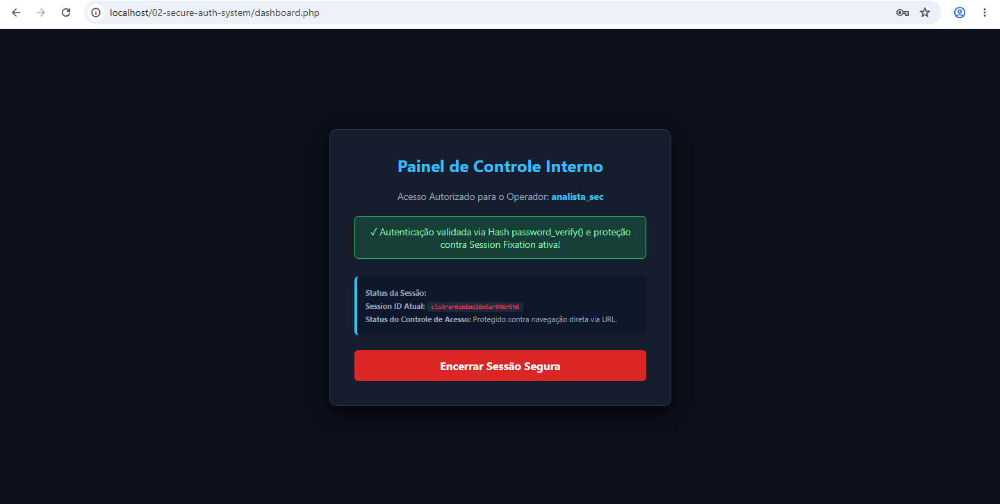

[ 🇺🇸 English ](README.md) | [ 🇪🇸 Español ](README.es.md) | [ 🇧🇷 Português ](README.pt.md)

---

# 🔒 Secure Authentication & Session Management System (PHP/HTML5)

A robust, defense-in-depth authentication system built with PHP and HTML5, designed to demonstrate secure session handling, password hashing, and mitigation of **Broken Access Control** (OWASP A01:2021) and **Broken Authentication** (OWASP A07:2021).

## 🎯 Purpose & Scope
This project implements a secure internal dashboard authentication workflow. It ensures that user credentials are protected in transit and at rest (memory/database simulation), while actively defeating session hijacking, fixation, and unauthorized direct URL traversal.

## 🛡️ Security Features Implemented
* **Secure Password Hashing:** Uses `password_hash()` with `PASSWORD_DEFAULT` (bcrypt/Argon2id algorithm) and `password_verify()` to prevent plain-text credential leaks or reverse lookup attacks.
* **Session Fixation Defense:** Triggers `session_regenerate_id(true)` upon successful authentication to destroy the pre-login session ID and issue a new secure identifier.
* **Broken Access Control Mitigation:** Restricts access to `dashboard.php` by strictly validating active `$_SESSION['authenticated']` flags. Unauthenticated requests are immediately rejected and redirected.
* **Inactivity Timeout:** Implements automatic session invalidation after 5 minutes (300s) of user inactivity to reduce session hijacking windows.
* **Complete Session Termination (`logout.php`):** Unsets session variables, destroys server-side session data, and expires the client-side session cookie (`PHPSESSID`).

## 🧪 Proof of Concept & Defense Tests
1. **Direct Access Bypass Attempt:**
   * **Action:** Direct HTTP GET request to `http://localhost/02-secure-auth-system/dashboard.php` without logging in.
   * **Result:** Blocked by backend validation; redirected to `index.php?error=unauthorized`.
2. **Session Identifier Renewal:**
   * **Action:** Check `session_id()` before and after login.
   * **Result:** Session ID is completely regenerated upon login, successfully mitigating Session Fixation threats.

## 🚀 How to Run
1. Clone this repository into your local server environment (e.g., XAMPP `htdocs/` or LAMP `/var/www/html/`).
2. Start the Apache service.
3. Open `http://localhost/02-secure-auth-system/index.php` in your browser.
4. **Test Credentials:**
   * **Username:** `analista_sec`
   * **Password:** `SenhaSegura@2026`

---
*Developed as part of the Cybersecurity Portfolio for international software & threat analysis roles.*